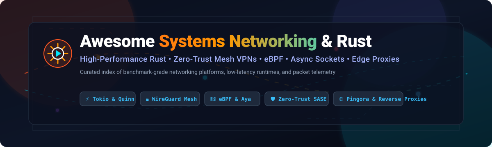

# 🚀 Awesome Systems Networking & High-Performance Rust

  

  
  
  
  
  
  

---

## ⚡ Top Systems Networking & High-Performance Rust Ecosystem

> **A curated showcase of enterprise SaaS/hosted platforms and high-throughput open-source Rust projects for modern systems networking, low-latency async runtimes, zero-trust mesh tunnels, eBPF packet inspection, and edge proxies.**

*Last updated: November 2026* 📅

---

### 🔍 Overview & SEO Highlights
Whether you are architecting a carrier-grade reverse proxy with Cloudflare's **Pingora**, orchestrating asynchronous I/O with **Tokio**, capturing line-rate packet streams via **Aya (eBPF)**, or setting up encrypted peer-to-peer overlay fabrics using **WireGuard**, this index delivers vetted benchmarks, pricing structures, and star-ranked repositories for systems engineers and network software architects.

---

## 📑 Table of Contents
- [📊 Sector Overview & Market Dynamics](#-sector-overview--market-dynamics)
- [☁️ SaaS & Hosted Networking Platforms](#️-saas--hosted-networking-platforms)
- [🛠️ Open-Source GitHub Projects (Ranked by Stars)](#️-open-source-github-projects-ranked-by-stars)
- [📈 Star History](#-star-history)
- [🤝 How to Contribute](#-how-to-contribute)
- [💖 Support & Sponsorship](#-support--sponsorship)
- [⚠️ Disclaimer](#️-disclaimer)

---

## 📊 Sector Overview & Market Dynamics

The global enterprise Secure Access Service Edge (SASE) and Zero Trust Network Access (ZTNA) sector is projected to surge from approximately **$6.8B–$8.8B in 2025/2026 to over $25B–$30B by 2030** (exceeding **$100B+** when encompassing end-to-end zero-trust network infrastructure and SASE security fabrics), compounding at an accelerated **24%–27% CAGR**. 

Market concentration remains **moderately concentrated at the hyperscale edge backbone tier**—dominated by massive infrastructure platforms like Cloudflare, Check Point, and Fastly that possess global multi-terabit Anycast transit networks—yet **highly dynamic and fragmented in the peer-to-peer mesh and software-defined overlay networking tier**, where specialized WireGuard implementations, self-hosted controllers, and kernel-bypass innovations continually challenge incumbent legacy VPN vendors.

---

## ☁️ SaaS & Hosted Networking Platforms

Below is the comparative breakdown of leading enterprise cloud and SaaS platforms powering zero-trust mesh tunnels, Anycast edge compute, and software-defined perimeter routing, **sorted in descending order by company valuation / market capitalization**:

| 🏢 Platform | 💰 Company Size (Valuation / Revenue) | 🏷️ Starting Paid Tier Pricing | 🎁 Free Tier / Free Trial Limits | 🌐 Key Networking Capabilities |
| :--- | :--- | :--- | :--- | :--- |
| **[Cloudflare Magic Transit & WARP](https://cloudflare.com)** | **$104B – $108B Market Cap** (~$2.96B ARR) | **$7.00 / user / month** (Pay-as-you-go Cloudflare One) | **Free forever up to 50 users** (ZTNA Access, Gateway DNS/HTTP, 24-hr log retention) | Global Anycast network security, DDoS scrubbers, and Rust-engineered edge proxies (Pingora & Oxy). |
| **[Fastly](https://fastly.com)** | **$2.4B – $2.6B Market Cap** (~$719M TTM Rev) | **$0.08 / GB bandwidth** + **$0.0075 / 10K requests** (Pay-as-you-go, ~$50/mo minimum) | **Free Developer Account** ($50 monthly recurring usage credit pool for CDN & Compute@Edge) | Programmable edge cloud, WebAssembly serverless runtimes, real-time log streaming, and DDoS mitigation. |
| **[Cato Networks](https://catonetworks.com)** | **$4.8B Valuation** (~$415M ARR) | **Custom Enterprise Quote** (Starts ~$1,200+/mo based on aggregated site bandwidth & user seats) | **30-day Proof of Concept (PoC) Trial** (Full access to CMA, virtual sockets, and ZTNA gateways) | Converged single-vendor SASE, global private backbone, integrated SD-WAN, and AI threat prevention. |
| **[NordLayer](https://nordlayer.com)** | **$3.0B Parent Valuation** (~$350M+ ARR, Nord Security) | **$8.00 / user / month** (Lite plan, billed annually; 5 user minimum) | **14-day Money-Back Guarantee** + live enterprise guided pilot demo | Turnkey corporate network access, dedicated IP gateways, multi-cloud tunnels, and biometric 2FA. |
| **[Tailscale](https://tailscale.com)** | **$1.5B Valuation** (~$45M ARR) | **$8.00 / user / month** (Standard plan, unlimited tailnet users) | **Free forever up to 6 users** (Unlimited devices/nodes, 3 ACL groups, non-commercial use) | Zero-config mesh overlay VPN powered by WireGuard, MagicDNS, and automated NAT traversal. |
| **[Perimeter 81 (Check Point Harmony SASE)](https://perimeter81.com)** | **$490M Acquisition** (Parent Check Point: ~$20B Cap) | **$8.00 / user / month** (Essentials tier; billed annually, 10 user minimum) | **Custom Assisted Pilot Trial** (Available upon request through sales demonstration) | Cloud-native Software-Defined Perimeter (SDP), split-tunneling, zero-trust gateways, and posture checking. |
| **[Twingate](https://twingate.com)** | **$400M Valuation** (Series B) | **$5.00 / user / month** (Teams tier, billed annually) | **Free forever up to 5 users** (Up to 5 devices per user, 1 remote network connector, 50 resources) | Invisible software-defined perimeters replacing legacy VPNs with granular, identity-centric routing. |
| **[ZeroTier](https://zerotier.com)** | **~$16M Total Capital** (~$5M ARR) | **$18.00 / month** (Essential plan; includes 10 devices, then $2.00/device/mo) | **Free forever up to 10 devices** (1 network, 1 network administrator, non-commercial use) | Global virtual Ethernet switch architecture connecting endpoints peer-to-peer over encrypted UDP. |
| **[Netmaker](https://netmaker.io)** | **~$7M Valuation** (~$2.8M Total Capital) | **$2.00 / active connection / month** (Team tier, daily active metered connections) | **Free forever Community Edition** (Unlimited devices & networks, Apache 2.0 self-hosted server) | WireGuard automated mesh orchestrator with egress gateways, private DNS, and Kubernetes operators. |

---

## 🛠️ Open-Source GitHub Projects (Ranked by Stars)

Each project below includes a live social Stars_Badge linking directly to its stargazer community. Entries are sorted in descending order by GitHub stargazers count:

1. **[Headscale](https://github.com/juanfont/headscale)**   
   *An open-source, self-hosted implementation of the Tailscale coordination server, delivering self-sovereign control over your private WireGuard mesh tailnet.* 🛡️

2. **[Sniffnet](https://github.com/GyulyVGC/sniffnet)**   
   *Cross-platform, open-source network monitoring desktop tool written in Rust with real-time throughput metrics, protocol breakdowns, and GeoIP filters.* 🕵️‍♂️

3. **[Tokio](https://github.com/tokio-rs/tokio)**   
   *The foundational asynchronous runtime for the Rust ecosystem, providing non-blocking TCP/UDP sockets, event-driven schedulers, and high-performance timers.* ⚡

4. **[NetBird](https://github.com/netbirdio/netbird)**   
   *Open-source zero-trust networking platform combining WireGuard encryption with WebRTC ICE hole-punching, central SSO, and multi-cloud routing.* 🌐

5. **[Pingora](https://github.com/cloudflare/pingora)**   
   *Cloudflare’s high-throughput async Rust framework for building customizable, memory-safe reverse proxies, TLS termination engines, and load balancers at scale.* 🚀

6. **[Actix Web](https://github.com/actix/actix-web)**   
   *Extremely fast, pragmatic web framework for Rust that tops synthetic HTTP benchmarks and handles concurrent network streaming with ease.* 🏎️

7. **[Vector](https://github.com/vectordotdev/vector)**   
   *High-performance, memory-efficient observability pipeline written in Rust designed for routing, transforming, and filtering multi-gigabit network telemetry and logs.* 📈

8. **[RustScan](https://github.com/bee-san/RustScan)**   
   *Ultra-fast asynchronous port scanner built in Rust that completes 65,000 port probes in under 3 seconds and pipes findings directly into Nmap.* 🤖

9. **[Nebula](https://github.com/slackhq/nebula)**   
   *Scalable, mutually authenticated overlay networking utility engineered at Slack, featuring automated NAT discovery and cryptographic host identities.* 🌌

10. **[Hyper](https://github.com/hyperium/hyper)**   
    *Protean, ultra-fast HTTP/1.1 and HTTP/2 implementation in Rust serving as the low-level building block for production web servers and proxies.* ⚡

11. **[SoftEther VPN](https://github.com/SoftEtherVPN/SoftEtherVPN)**   
    *High-performance, multi-protocol VPN engine supporting OpenVPN, IPsec, L2TP, and SSTP with virtual NAT and hardware acceleration.* 💻

12. **[Quiche](https://github.com/cloudflare/quiche)**   
    *Cloudflare's implementation of the IETF QUIC transport protocol and HTTP/3 written in Rust with C and Python FFI bindings.* 🥧

13. **[Bandwhich](https://github.com/imsnif/bandwhich)**   
    *Terminal bandwidth utilization sniffer written in Rust that correlates live socket activity back to individual process IDs and remote hostnames.* 📊

14. **[Reqwest](https://github.com/seanmonstar/reqwest)**   
    *Ergonomic, batteries-included async HTTP client for Rust built on Hyper with connection pooling, gzip/brotli compression, and proxy routing.* 📨

15. **[Firezone](https://github.com/firezone/firezone)**   
    *Zero-trust network access platform and WireGuard-powered gateway written primarily in Rust for secure, granular access to private clusters and VPCs.* 🔥

16. **[Trippy](https://github.com/fujiapple852/trippy)**   
    *Modern network diagnostic TUI combining traceroute and ping with multipath ICMP/UDP probing, ASN lookups, and hop-by-hop latency statistics.* 🧭

17. **[BoringTun](https://github.com/cloudflare/boringtun)**   
    *Cloudflare's userspace implementation of the WireGuard protocol in Rust designed for line-rate encrypted tunneling without kernel module dependencies.* 🔒

18. **[Rust-Libp2p](https://github.com/libp2p/rust-libp2p)**   
    *The official Rust implementation of the libp2p modular peer-to-peer networking stack powering distributed applications, IPFS, and blockchain protocols.* 🕸️

19. **[Innernet](https://github.com/tonarino/innernet)**   
    *A private network system written in Rust that creates peer-to-peer WireGuard mesh topologies controlled by CIDR-scoped ACL permissions.* 🔑

20. **[Hickory DNS](https://github.com/hickory-dns/hickory-dns)**   
    *Safe, modern DNS client, server, and recursive resolver written in Rust supporting DNS-over-HTTPS (DoH), DNS-over-TLS (DoT), and DNSSEC verification.* 🌳

21. **[Quinn](https://github.com/quinn-rs/quinn)**   
    *Async-friendly, pure-Rust implementation of the IETF QUIC transport protocol featuring multiplexed byte streams, 0-RTT handshakes, and pluggable crypto.* 🚀

22. **[RustNet](https://github.com/domcyrus/rustnet)**   
    *Per-process terminal network monitor written in Rust with deep packet inspection (DPI), eBPF process attribution, and zero-privilege sandboxing.* 🔬

23. **[Smol](https://github.com/smol-rs/smol)**   
    *A small, simple, and blazingly fast async runtime for Rust that provides lightweight async epoll/kqueue bindings with minimal dependencies.* ⚡

24. **[Aya](https://github.com/aya-rs/aya)**   
    *Pure-Rust eBPF framework that allows compiling and loading Linux kernel networking programs (XDP, TC filters, socket schedulers) without C or LLVM dependencies.* 🐝

25. **[Smoltcp](https://github.com/smoltcp-rs/smoltcp)**   
    *Standalone, event-driven TCP/IP stack written in Rust engineered for bare-metal targets, embedded microcontrollers, and userspace OS networking.* 📡

26. **[Ockam](https://github.com/build-trust/ockam)**   
    *Suite of open-source Rust tools and cryptographic protocols to orchestrate end-to-end encrypted, mutually authenticated tunnels across cloud VPCs and edge devices.* 🔐

27. **[Defguard](https://github.com/DefGuard/defguard)**   
    *Open-source enterprise WireGuard 2FA/MFA management platform with hardware security key (YubiKey) support, Webhooks, and automated desktop agents.* 🛡️

28. **[Libpnet](https://github.com/libpnet/libpnet)**   
    *Cross-platform, low-level packet manipulation library for Rust providing access to raw Ethernet/IP network interfaces and packet crafting.* 📦

29. **[Linkerd2-Proxy](https://github.com/linkerd/linkerd2-proxy)**   
    *Ultra-lightweight, zero-config service mesh sidecar proxy written in Rust, engineered for minimal memory overhead and microsecond latency.* 🛰️

30. **[Rama](https://github.com/plabayo/rama)**   
    *Modular, service-oriented network framework for Rust designed to transform, proxy, and route network packets across HTTP, TLS, SOCKS5, and TCP layers.* 🧩

---

## 📈 Star History

---

## 🤝 How to Contribute

Contributions are warmly encouraged! Follow these steps to submit additions or improvements:

1. 🍴 **Fork the repository** on GitHub.
2. 🌿 **Create a topic branch** (`git checkout -b feat/add-awesome-project`).
3. 📝 **Update `README.md`** following the existing table or list formatting.
4. ✅ **Ensure accuracy**: Provide factual links, explicit pricing or Stars_Counts, and objective descriptions.
5. 🚀 **Submit a Pull Request** with a concise summary of why the library or platform belongs here.

---

## 💖 Support & Sponsorship

If this curated systems networking directory saved you time, introduced you to a great Rust crate, or helped your infrastructure planning, please consider supporting the project:

- ⭐ **Star this repository** to help others discover it!
- 🍴 **Fork & Share** with fellow systems engineers and network developers.
- ☕ **Buy a coffee & sponsor our open-source research** via the [GitHub Sponsors Dashboard](https://github.com/sponsors/ishandutta2007).

Your backing fuels ongoing benchmarks, continuous curation, and comprehensive systems engineering guides. Thank you! 🙏

---

## ⚠️ Disclaimer

- This curated collection is compiled for educational, engineering, and architectural research purposes; mention does not constitute a commercial endorsement.
- Low-level network utilities (eBPF, raw sockets, packet capture) require elevated system permissions (`sudo`, `CAP_NET_RAW`, `CAP_BPF`, or Npcap) and must only be executed on networks and infrastructure you are authorized to monitor.
- All trademarks and brand names belong to their respective holders.

---

  <b>Crafted with ❤️ for systems programmers, network engineers, Rustaceans, and infrastructure architects worldwide.</b>

